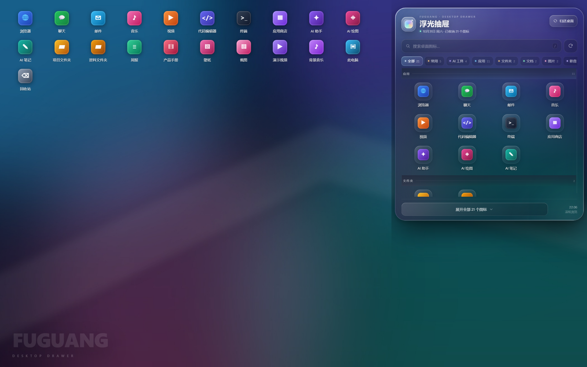
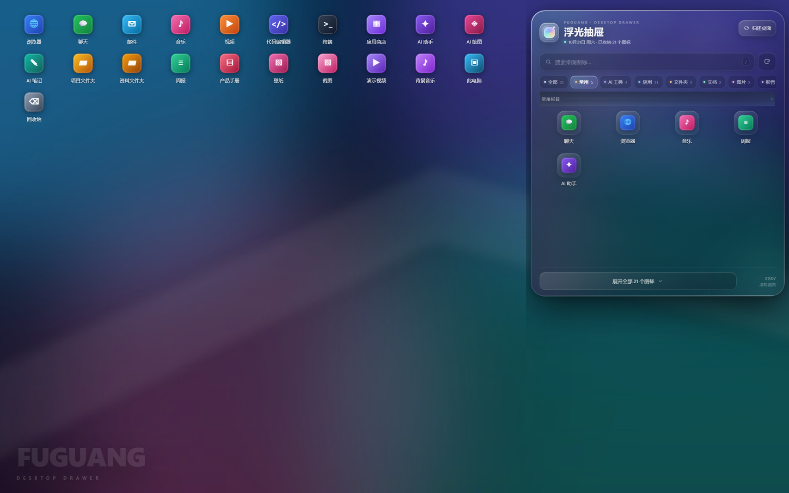
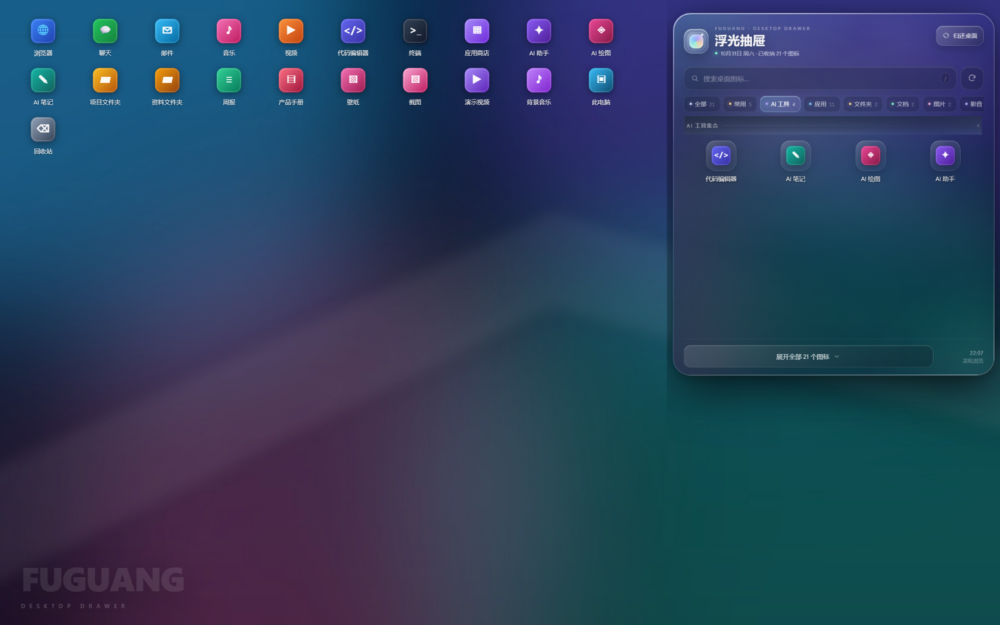
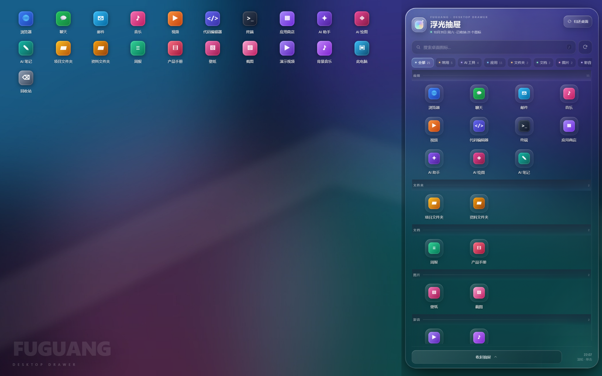

# 浮光抽屉 · Fuguang Drawer

[](https://github.com/Luckwolfwangwang/fuguang-drawer/stargazers)
[](LICENSE)

一个 Windows 桌面图标收纳器：把桌面图标收进屏幕右侧的玻璃抽屉，桌面保持干净；鼠标移到右侧玻璃小条上，抽屉才会出现，不用时一键归还。

> Screenshots use demo icons and names. The real app uses native Windows shell icons.



## 功能

- 右侧 1/3 宽玻璃抽屉，悬停玻璃条才展开
- 类似 ColorOS 的液态玻璃观感：圆角、磨砂、高光、边缘折射
- 图标自动分类：应用 / 文件夹 / 文档 / 图片 / 影音 / 系统 / 其他
- 「常用」与「AI 工具」两个整理栏目
  - 常用：优先显示固定项，并把打开过的应用按使用次数加入
  - AI 工具：自动识别常见 AI 应用，也可以右键手动加入/移除
- 搜索（`/` 或 `Ctrl+F`）、滚轮浏览、右键菜单
- 右键重命名，或打开完整 Windows 功能菜单（剪切 / 复制 / 删除 / 属性 / 发送到 / 打开方式）
- 单击图标打开；支持 `.lnk` / `.url` / 文件夹 / 普通文件
- 点「展开全部」下拉，点「归还桌面」一键还原并退出
- 图标只通过 Windows 的“显示桌面图标”开关隐藏，**不移动文件，也不改动图标坐标**
- 抽屉背后的桌面会实时截取并做磨砂，颜色随壁纸变化
- 单实例、系统托盘、退出自动还原
- 登录还原保护：如果关机/崩溃时没来得及还原，下次登录自动把图标放回来
- 窗口自愈：启动后自动重绘，避免登录早期透明窗口空白
- 本地运行，不联网，不收集数据







## 使用

1. 双击桌面上的 **浮光抽屉** 快捷方式。
2. 桌面图标会隐藏，屏幕右侧出现一条玻璃小条。
3. 鼠标移到小条上，抽屉展开。
4. 点底部「展开全部」拉满抽屉，滚轮浏览。
5. 点右上角「归还桌面」还原并退出。

| 操作 | 效果 |
| --- | --- |
| 鼠标移到右侧玻璃条 | 展开抽屉 |
| 点底部「展开全部」 | 抽屉拉满，显示所有分类 |
| 滚轮 | 浏览图标；预览状态滚到底会继续展开 |
| `/` 或 `Ctrl+F` | 搜索桌面图标 |
| `Esc` | 清空搜索 / 收起 / 关闭 |
| 右键图标 | 重命名、加入/移出常用、加入/移出 AI 工具集合、更多 Windows 功能、打开位置、复制路径、复制名称 |
| 右上角「归还桌面」 | 还原图标并退出 |

### 如果开机后看不到玻璃条或图标

- 最大化/全屏应用可能挡住最右侧的玻璃条：按 `Win + D` 回到桌面，或最小化全屏窗口。
- 如果程序被强制结束、图标没有回来：开始菜单搜索 **还原桌面图标（浮光抽屉）**，或右键桌面 → 查看 → 显示桌面图标。
- 程序现在带有登录还原保护；正常退出时会自动删除保护任务。
- 托盘图标菜单里有 **修复显示（重建玻璃条）**，可强制刷新窗口。

### 需要开机自动启动吗？

**不需要。** 这不是开机启动问题。程序只在需要时打开即可；开机自启适合“希望一开机就进入收纳状态并一直运行”的场景，但会让每次登录都隐藏图标。

如果确实需要，可以把快捷方式复制到 `shell:startup` 文件夹。

## 安装 / 构建

### 直接使用

从 [Releases](https://github.com/Luckwolfwangwang/fuguang-drawer/releases) 下载便携版压缩包，解压后双击 `FuguangDrawer.exe`；建议同时创建桌面快捷方式。

> 便携包必须保留同目录的 `resources` 文件夹，不能只复制 exe。

### 从源码运行

要求：Windows 11、Node.js 20+。

```powershell
git clone https://github.com/Luckwolfwangwang/fuguang-drawer.git
cd fuguang-drawer
npm install
npm start
```

### 打包便携版

```powershell
npm run package
```

输出在 `release/浮光抽屉-win32-x64/`，双击 `FuguangDrawer.exe` 即可。`release/` 不提交到 Git，建议作为 GitHub Release 附件上传。

## 项目结构

```
src/
  main.js                 Electron 主进程：窗口、悬停、扫描、还原、启动保护
  preload.js              contextBridge API
  icon-utils.js           .lnk / .url 图标源解析
  icon-extract.js         调用 PowerShell 提取系统图标
  renderer/
    index.html            抽屉界面
    styles.css            玻璃、布局、动画
    renderer.js           分类、搜索、滚动、交互
scripts/
  desktop-icons.ps1       切换 Windows 显示桌面图标
  extract-icons.ps1       批量提取 256px 系统图标
  IconExtractor.cs        SHGetImageList 图标提取器源码
  IconExtractor.dll       编译后的提取器
  restore-at-login.ps1    登录还原保护
  restore-at-login.vbs    RunOnce 无窗口包装
assets/                   应用图标
docs/                     公开演示截图
tools/make-icon.py        生成应用图标
```

## 实现说明

- **隐藏图标**：调用 Windows 的“显示桌面图标”命令（`SHELLDLL_DefView` + `WM_COMMAND 0x7402`），只改变显示状态；文件与坐标不变，所以还原就是原位。
- **图标提取**：通过 `SHGetFileInfo` + `SHGetImageList(SHIL_JUMBO)` 提取 256px 图标，并裁掉透明留白，修复小尺寸资源图标只显示一角的问题。
- **玻璃背景**：展开前用 `desktopCapturer` 截取抽屉背后的屏幕区域，模糊后作为抽屉背景；不依赖 DWM acrylic，兼容性更好。
- **登录保护**：成功隐藏图标后写入 `HKCU\...\RunOnce\FuguangRestoreIcons`；正常还原时删除。RunOnce 指向无窗口 VBS，登录时恢复图标。
- **窗口自愈**：启动后做一次 1px 重绘、刷新和置顶，避免 Windows 登录早期透明窗口绘制表面为空。

## 隐私

- 不连接网络，不上传任何桌面内容
- 日志只写在 `%APPDATA%\FuguangDrawer\app.log`
- 截屏只用于本机绘制玻璃背景，不保存、不上传

## 已知限制

- 仅支持 Windows；透明/磨砂效果在 Windows 10 上会弱一些
- 全屏游戏/全屏视频可能覆盖置顶窗口，这是 Windows 全屏优化行为
- 首次启动需要允许 PowerShell 执行脚本（程序使用 `-ExecutionPolicy Bypass`，不会修改系统策略）
- 未签名 exe 可能触发 SmartScreen：点“更多信息” → “仍要运行”

## 作者

**Luckwolfwangwangzbs** · [GitHub @Luckwolfwangwang](https://github.com/Luckwolfwangwang)

这个项目覆盖了 Windows Shell 集成、系统图标提取、Electron 透明窗口、桌面图标原位还原和异常退出保护。如果它对你的桌面有帮助，欢迎点一个 ⭐ Star，这是对我继续维护最大的鼓励。

## License

MIT. See [LICENSE](LICENSE).

更新记录见 [CHANGELOG.md](CHANGELOG.md).

---

**English**: Fuguang Drawer is a Windows desktop organizer that tucks desktop icons into a right-side glass drawer. Hover the edge strip to reveal it, scroll to browse, right-click to curate favorites/AI tools, and click “Return to desktop” to restore icons in place. Icons are hidden via the Windows show-desktop-icons toggle; files and positions are untouched. No network, no telemetry.
